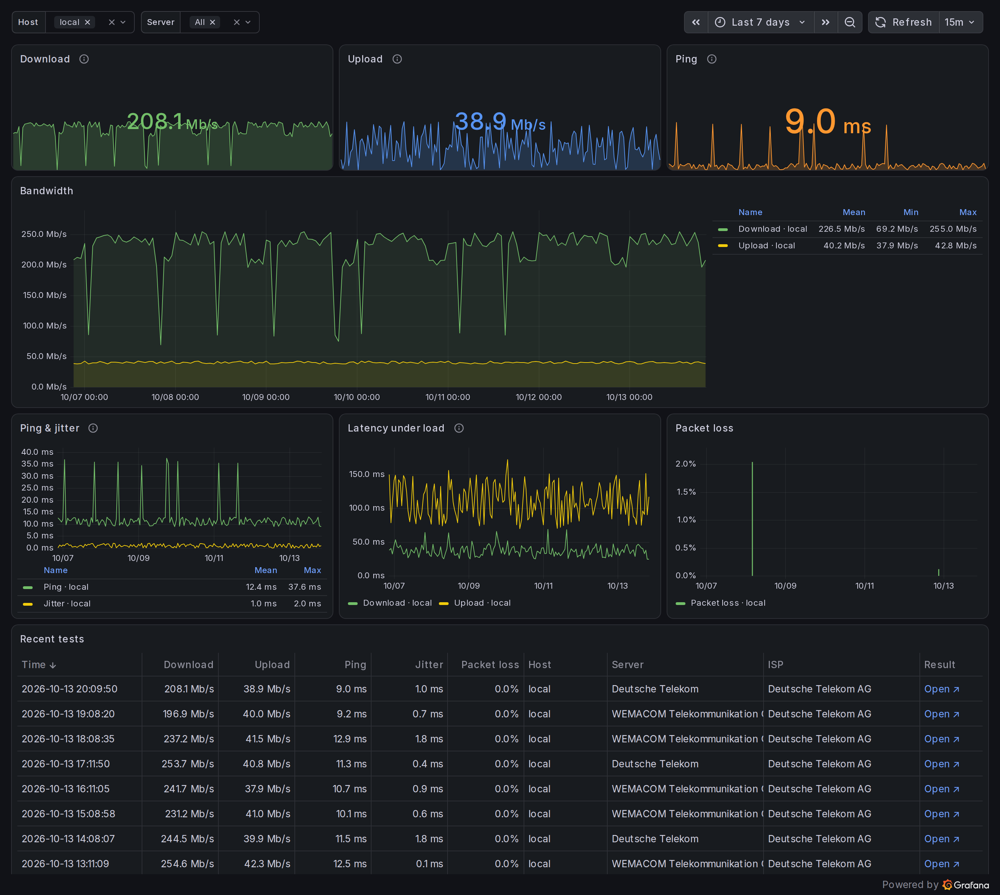

# docker-speedtest-grafana

Track your internet connection in Grafana. A small container runs the official [Speedtest CLI by Ookla](https://www.speedtest.net/apps/cli) on a schedule and writes every result to InfluxDB. Grafana comes with a ready-made dashboard for download, upload, ping, jitter, latency under load and packet loss.



## Requirements

- Docker with Compose v2 (`docker compose`)
- A 64-bit host (amd64 or arm64). On a Raspberry Pi this means a 64-bit OS; InfluxDB 1.12 has no 32-bit images. The speedtest image itself also runs on armv7, see [Using an existing InfluxDB](#using-an-existing-influxdb-and-grafana).

## Quickstart

```shell
git clone https://github.com/frdmn/docker-speedtest-grafana
cd docker-speedtest-grafana
cp .env.sample .env
```

Set the two passwords in `.env`, e.g. with values from `openssl rand -hex 24`:

```shell
GRAFANA_ADMIN_PASSWORD=...
INFLUXDB_PASSWORD=...
```

Start the stack:

```shell
docker compose up -d
```

Open [http://localhost:3000](http://localhost:3000), log in as `admin` with `GRAFANA_ADMIN_PASSWORD` and open the **Speedtest** dashboard. The first test runs right away; after that every hour.

## Configuration

All settings live in `.env`:

| Variable | Default | Description |
|---|---|---|
| `GRAFANA_ADMIN_PASSWORD` | – | **Required.** Password of the Grafana `admin` user |
| `INFLUXDB_PASSWORD` | – | **Required.** Password of the `speedtest` InfluxDB user, shared by the runner and Grafana |
| `GRAFANA_PORT` | `3000` | Port Grafana listens on |
| `GRAFANA_ANONYMOUS` | `false` | `true` lets anyone view the dashboards without logging in |
| `INFLUXDB_ADMIN_PASSWORD` | generated | InfluxDB `admin` password. If empty, one is generated on first start and printed once: `docker compose logs influxdb \| grep ADMIN_PASSWORD` |
| `SPEEDTEST_HOST` | `local` | Name for this runner, stored as the `host` tag. Useful with [several locations](#several-locations) |
| `SPEEDTEST_INTERVAL` | `3600` | Seconds between test runs |
| `SPEEDTEST_CRON` | – | Cron schedule instead of the interval, e.g. `0 * * * *` for every full hour |
| `SPEEDTEST_SERVER` | – | Comma-separated Ookla server IDs. Empty: Ookla picks a nearby server for each run |
| `TZ` | `UTC` | Time zone for `SPEEDTEST_CRON` and log timestamps, e.g. `Europe/Berlin` |

Apply changes with `docker compose up -d`.

### Schedule

By default a test runs on start and then every `SPEEDTEST_INTERVAL` seconds. To test at fixed times instead, set a cron schedule and your time zone:

```shell
SPEEDTEST_CRON=0 */2 * * *   # every two hours, on the hour
TZ=Europe/Berlin
```

### Test servers

List the servers near you:

```shell
docker compose run --rm --entrypoint speedtest speedtest --accept-license --accept-gdpr -L
```

Pin one or more by ID. Several servers are tested one after another, never at the same time:

```shell
SPEEDTEST_SERVER=75868,54577
```

Use the **Server** filter on the dashboard to compare them.

A single test takes up to `SPEEDTEST_TIMEOUT` seconds (default `300`) before it is aborted.

## Data

Each test writes one point to the `speedtest` measurement:

| Name | Kind | Unit | Description |
|---|---|---|---|
| `host` | tag | | `SPEEDTEST_HOST` |
| `server_id`, `server_name`, `server_location` | tag | | Ookla test server |
| `isp` | tag | | Your provider, as detected by Ookla |
| `download`, `upload` | field | Mbit/s | Bandwidth |
| `ping`, `jitter`, `ping_low`, `ping_high` | field | ms | Latency on an idle connection |
| `download_latency`, `upload_latency` | field | ms | Latency while the line is loaded (interquartile mean) |
| `packet_loss` | field | % | Not reported by every server |
| `download_bytes`, `upload_bytes` | field | bytes | Data transferred |
| `external_ip`, `result_url` | field | | Public IP, link to the result on speedtest.net |

### Example queries

Open an InfluxDB shell:

```shell
docker compose exec influxdb sh -c 'influx -username speedtest -password "$INFLUXDB_USER_PASSWORD" -database speedtest -precision rfc3339'
```

Daily averages for the last week:

```sql
SELECT mean("download"), mean("upload") FROM "speedtest" WHERE time > now() - 7d GROUP BY time(1d), "host" fill(none)
```

The download speed you get at least 95 % of the time:

```sql
SELECT percentile("download", 5) FROM "speedtest" WHERE time > now() - 30d GROUP BY "host"
```

Number of tests below 100 Mbit/s in the last 30 days:

```sql
SELECT count("download") FROM "speedtest" WHERE "download" < 100 AND time > now() - 30d GROUP BY "host"
```

Averages per test server:

```sql
SELECT mean("download"), mean("ping") FROM "speedtest" WHERE time > now() - 30d GROUP BY "server_name"
```

## Several locations

Runners at other locations can write to the same InfluxDB. InfluxDB is not reachable from outside the stack by default; publish its port with a `docker-compose.override.yml` next to `docker-compose.yml`:

```yaml
services:
  influxdb:
    ports:
      - "8086:8086"
```

Then start a runner on the other machine with its own `SPEEDTEST_HOST`:

```shell
docker run -d --name speedtest --restart unless-stopped \
  -e INFLUXDB_URL=http://<stack-host>:8086 \
  -e INFLUXDB_PASSWORD=<INFLUXDB_PASSWORD> \
  -e SPEEDTEST_HOST=office \
  frdmn/speedtest-grafana:2
```

The dashboard's **Host** filter switches between locations.

## Using an existing InfluxDB and Grafana

The speedtest image works on its own with any InfluxDB 1.x. Create a database and user first:

```sql
CREATE DATABASE speedtest
CREATE USER speedtest WITH PASSWORD '<password>'
GRANT ALL ON speedtest TO speedtest
```

Then run only the runner:

```shell
docker run -d --name speedtest --restart unless-stopped \
  -e INFLUXDB_URL=http://<influxdb>:8086 \
  -e INFLUXDB_PASSWORD=<password> \
  frdmn/speedtest-grafana:2
```

| Variable | Default | Description |
|---|---|---|
| `INFLUXDB_URL` | `http://influxdb:8086` | InfluxDB base URL |
| `INFLUXDB_DB` | `speedtest` | Database |
| `INFLUXDB_USERNAME` | `speedtest` | User |
| `INFLUXDB_PASSWORD` | – | **Required.** Password |
| `SPEEDTEST_TIMEOUT` | `300` | Seconds before a single test is aborted |

All `SPEEDTEST_*` variables and `TZ` from [Configuration](#configuration) work the same way.

For the dashboard, import [`speedtest.json`](docker/grafana/provisioning/dashboards/speedtest.json) into Grafana. It expects an InfluxDB data source (query language InfluxQL) with the UID `influxdb`; with a different UID, pick your data source in each panel and in the dashboard's two variables after the import.

The image is available on Docker Hub (`frdmn/speedtest-grafana`) and GitHub (`ghcr.io/frdmn/speedtest-grafana`) for amd64, arm64 and armv7.

## Operations

```shell
docker compose logs -f speedtest            # test results and errors
docker compose pull && docker compose up -d # update to the latest images
docker compose down                         # stop; data stays in the Docker volumes
```

A failed test (no connection, server unavailable, timeout) is logged and skipped; the next run happens as scheduled.

### Firewall

The Speedtest CLI needs outbound **TCP 443** (configuration and server list) and the test server's port, **TCP 8080** for almost all servers. If either is blocked, `docker compose logs speedtest` shows the error.

## Upgrading from v1

v2 stores results in a new format, uses Docker volumes instead of `./data`, and needs a new `.env`. Your v1 history can be imported. To stay on v1 instead, pin the image to `frdmn/speedtest-grafana:1`.

1. Stop v1 and update the repository:

   ```shell
   docker compose down
   git pull
   ```

2. Set up `.env` as in the [Quickstart](#quickstart) (`cp .env.sample .env`, set both passwords) and start v2:

   ```shell
   docker compose up -d
   ```

3. Import the v1 data from `./data/influxdb`. It is only read, never changed:

   ```shell
   docker run --rm --user root -v "$PWD/data/influxdb:/var/lib/influxdb:ro" influxdb:1.12.4 \
     influx_inspect export -datadir /var/lib/influxdb/data -waldir /var/lib/influxdb/wal \
     -database speedtest -lponly -out /dev/stdout \
   | sed -nE 's/^(download|upload|ping),(.*) value=/speedtest,\2 \1=/p' \
   | docker compose exec -T speedtest sh -c 'curl -fsS -u "speedtest:$INFLUXDB_PASSWORD" --data-binary @- "$INFLUXDB_URL/write?db=speedtest&precision=n"'
   ```

   The old download, upload and ping values show up on the new dashboard. Fields v1 did not record (jitter, packet loss, server, …) stay empty for that period.

4. Once you are happy, delete `./data/influxdb`.

## Speedtest license

The image contains the Speedtest CLI by Ookla and accepts its license and GDPR terms on your behalf (`--accept-license --accept-gdpr`). The CLI is licensed for personal, non-commercial use; see the [Ookla EULA](https://www.speedtest.net/about/eula) and [privacy policy](https://www.speedtest.net/about/privacy). Every result is also uploaded to speedtest.net (that is where `result_url` points).

## Contributing

Issues and pull requests are welcome. The runner is a shell script ([`docker/speedtest/speedtest.sh`](docker/speedtest/speedtest.sh)) plus a jq filter that converts Ookla's JSON to InfluxDB line protocol ([`to-lp.jq`](docker/speedtest/to-lp.jq)). Check the filter with:

```shell
docker build -t speedtest-grafana:dev docker/speedtest
docker run --rm -v "$PWD/docker/speedtest:/t" -w /t --entrypoint sh speedtest-grafana:dev test.sh
```

## License

[MIT](LICENSE)
